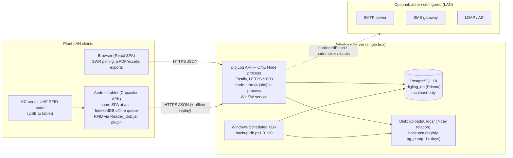

# 01 — Architecture and Dependency Audit

Verified 2026-10-17 against branch `RFID` @ `755f0ae` by reading the code, the installer scripts and
the running dev database. File references are `path:line`.

## 1. What runs where

| Component | Runs on | Notes |
|---|---|---|
| React SPA | client browser / tablet WebView | built with Vite; PDFs/Excel are generated **in the browser** (`jspdf`, `exceljs` in `apps/web/package.json`) |
| Offline queue + sync engine | tablet | IndexedDB; replays to `/api/filters/*` with an offline-replay grant (`plugins/auth.ts`, `isOfflineReplayRoute`) |
| RFID | tablet + USB reader | native plugin `RfidPlugin.java`; scans normalised by `apps/web/src/lib/rfid-scan.ts`. No server-side device communication |
| API | server | single Fastify process, `app.listen` at `apps/api/src/app.ts:728`; no cluster / worker threads |
| Scheduler | inside the API process | `session_sweep` 5 min, `password_expiry_check` 00:00, `log_retention` 00:05, `pm_overdue_check` 03:00 — stop whenever the API stops |
| Database | server | PostgreSQL 18, one database; installer provisions it localhost-only (`scripts/provision-db.ps1`) |
| Backups | server | `scripts/backup-db.ps1`: plain-SQL `pg_dump` → `<DataRoot>\backups\nightly-*.sql`, 14-day retention, same disk |

## 2. Backend

- **Runtime:** Node (dev box: v24.14.1; installer ships its own Node — see `scripts/stage-runtime.ps1`).
- **Framework:** Fastify with `@fastify/cors`, `helmet`, `rate-limit` (`global:false`, 3 routes), `multipart`, `static` (`/uploads/`), `swagger` (opt-in `API_DOCS=on`).
- **Modules:** 33 under `apps/api/src/modules/`; **429 operations** in the OpenAPI spec (inventory: `03_API_ENDPOINT_INVENTORY.md`).
- **Body limit:** 10 MB globally (`app.ts:159`, base64 checklist images); 4 KB on `/login`.
- **Auth:** JWT (`jose`) + server-side `sessions` row. Per-request user/session lookups are cached 30 s in process memory; the `lastActiveAt` write is debounced to once per 60 s per session (`plugins/auth.ts:104-114`). Single active session per user (SESSION_CONFLICT unless `force`).
- **Passwords:** native `bcrypt` cost 12 (`lib/password.ts:3`), async on the libuv threadpool (default 4 threads; `UV_THREADPOOL_SIZE` not set).
- **Re-auth (e-signature):** `_currentPassword` in the body → one bcrypt compare per signed action (`lib/reauth-check.ts`).
- **Audit trail:** every audited write calls `auditLog()` (`lib/audit.ts`), which takes the global `pg_advisory_xact_lock(AUDIT_CHAIN_LOCK_ID)` (`audit.ts:194`), reads the last chain row and inserts the next. Held until the surrounding transaction commits ⇒ **all audited writes in the app are serialised.**
- **Outbound calls:** only to admin-configured URLs via `lib/ssrf.ts` (`hardenedFetch`), SMTP via `nodemailer`, LDAP via `ldapts`. None is required for normal operation.
- **Logging:** pino → `<LOG_DIR>/app/<channel>/`, 7-day retention (`lib/log-retention.ts`); stdout captured by WinSW.
- **Process manager:** WinSW Windows services (installer); `DigiLogAPI-Phase5`/`DigiLogWeb-Phase5` (NSSM) exist on the dev box but are disabled.

## 3. Database

- PostgreSQL 18. **61 Prisma models / 24 enums** (CLAUDE.md, verified by the doc-sync greps).
- Extensions present: `plpgsql, pgcrypto, ltree`. `pg_stat_statements` **not** loaded (enabled in config 2026-10-17 for testing, pending restart).
- Settings (dev and installer alike): `max_connections=100`, `shared_buffers=128MB`, other memory settings at defaults. Installer only sets port, `listen_addresses=localhost` and logging (`provision-db.ps1:106-127`), including `log_lock_waits=on` and `log_min_duration_statement=1000`.
- Prisma pool: **default** (no `connection_limit` / `pool_timeout` in `DATABASE_URL`).
- Integrity guards: `audit_trail` no-DELETE trigger; partial unique index `asset_instances_active_name_key`; hash chain (`previous_checksum`, `chain_position BIGSERIAL`).
- Data on the dev box today: 26 MB, ~empty (post-wipe baseline). **No production-scale data has ever existed** in any environment we can see.

## 4. Frontend

- React + Vite SPA, SWR for data, react-hook-form, IBM Plex fonts **self-hosted**.
- ~30 timer-driven SWR polls (10–60 s). Detailed per-page analysis: `05a_FRONTEND_STATIC_AUDIT.md`.
- 77 routes in `main.tsx`.

## 5. Android / RFID

- Capacitor wrapper (`apps/android/`), HTTPS to the server with the LAN root CA installed on the tablet.
- Server discovery on IP change: native `ServerScanPlugin.java`, matched on `/api/health` `serverId`.
- Offline: IndexedDB queue, owner-scoped, replay with `clientOpId` idempotency keys + `offlinePerformedAt`.
- `rfid_scan_app/` is a separate native Kotlin scanner app.

## 6. Network, TLS, ports

- One port: API HTTPS (`PORT`, 3000 by default), driven by `digilog-addresses.ini` (cert SANs, `ALLOWED_ORIGINS`, firewall).
- LAN certificate issued by a local root CA covering the server's /24 (`scripts/issue-lan-cert.ps1`).
- Postgres listens on localhost only.

## 7. Internet dependencies

| When | Dependency | Required? |
|---|---|---|
| Build | npm registry, Gradle/Maven, JDK/SDK downloads | yes (developer machine only) |
| Install | none intended — installer bundles Node, PostgreSQL binaries, app (`build-installer.ps1`) | **unverified** (clean offline install never tested) |
| Runtime | none in code; outbound only to admin-configured LAN services | verified in code; to be confirmed by `05a` (frontend URLs) |
| Runtime prerequisite | VC++ redistributable (memory: installer needs it) | must be bundled or pre-installed |

## 8. Startup order and restart

Postgres service → API service (WinSW). Health: `GET /api/health` → `{status, db, jobRunner, serverId}`.
Restart-on-failure behaviour of the WinSW service and Prisma reconnect after a Postgres restart are
**not yet measured** (Phase 7).

## 9. Architectural constraints that shape capacity

1. One event loop ⇒ CPU-heavy work in any request delays every request (≈1 core usable on a 12-core server).
2. One global audit lock ⇒ audited-write throughput is bounded by the duration of the longest audited transaction.
3. In-process caches (auth 30 s, config 60 s) ⇒ running several API processes would need cache invalidation work; it is **not** a drop-in change.
4. Cron jobs inside the API ⇒ a second process would run them twice unless guarded.
