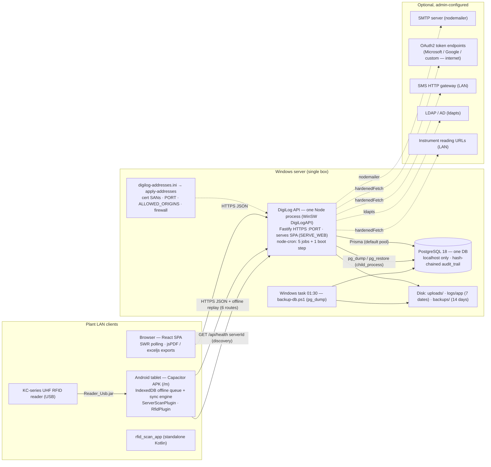

# 01 — Architecture Audit (Phase 1)

Production-readiness campaign, Round 1. Written 2026-10-21 by a read-only agent (no code, database,
server or test-suite was touched; no test was run).

| Item | Value |
|---|---|
| Commit audited | `7cb6dba` (branch `RFID`, HEAD at 2026-10-21 17:31 IST) |
| Working tree at snapshot (2026-10-21 12:19 UTC) | `apps/web/src` 106 modified files (UI restyle agents); `apps/api` only untracked **test** files (coverage agents); `packages/shared`, `apps/api/prisma`, `scripts`, `installer` clean. **Backend and shared numbers below are therefore the same at HEAD and in the working tree.** Web numbers were taken from both and agree (hooks 29, lib 46, `<Route` 77). |
| Evidence legend | **VERIFIED 2026-10-21** = re-measured on 7cb6dba by the command given in the row or in Appendix B. **CARRIED FORWARD &lt;date&gt;** = taken from an earlier report, with a pointer; not re-measured. |
| Earlier reports used | `docs/production-readiness/01_ARCHITECTURE_AND_DEPENDENCY_AUDIT.md` (2026-10-17, `755f0ae`), `03_API_ENDPOINT_INVENTORY.md` (2026-10-17), `QA/_discovery/*.md` (2026-10-19), `QA/PHASE4_ROLE_MATRIX.md` / `QA/PHASE5_WRITE_ABUSE.md` (2026-10-21) |

What changed since the 10-17 audit (from `git log 755f0ae..7cb6dba` and CHANGELOG): the 10-17 load-test
fixes, the 10-19 QA fixes (`4ddd2cd`), the per-site tablet APK (`a6e404a`), the 10-21 Phase 4/5 fixes and
placeholder tablet CA (`70adf40`), removal of the VIEWER / MAINTENANCE roles (`edf0955`), and the
sidebar-save reason rule (`7cb6dba`). Each is reflected below.

---

## 1. Component inventory

### 1.1 What runs where

| Component | Path | Language / framework | Runs on | Evidence |
|---|---|---|---|---|
| API | `apps/api` | TypeScript, Fastify 5.12.5, Prisma 6.19.x, Node | Windows server, ONE Node process (WinSW service `DigiLogAPI`), HTTPS | VERIFIED 2026-10-21 (`package-lock.json`; `app.ts:780` `app.listen`) |
| Web SPA | `apps/web` | TypeScript, React 19.2.4, Vite 7.3.6, Tailwind 4.1.18, SWR 2.4.0, react-hook-form, react-router-dom 7.18.2 | browser; also served by the API when `SERVE_WEB=true` (`app.ts:730-773`) | VERIFIED 2026-10-21 |
| Tablet app | `apps/android` | Capacitor 8.3.0 wrapper around the same SPA (`/m`), Java native plugins `RfidPlugin.java`, `ServerScanPlugin.java`, `Reader_Usb.jar` SDK | Android tablet (minSdk 24, target/compile 36, AGP 8.13.0) | VERIFIED 2026-10-21 (`apps/android/android/variables.gradle:2-4`, `app/build.gradle:1-11`, `MainActivity.java:13,15`) |
| RFID scanner app | `rfid_scan_app` | Kotlin 2.0.21 + Jetpack Compose (BOM 2024.09.00), AGP 8.13.2 | Android (minSdk 26, target 36) — separate standalone app | VERIFIED 2026-10-21 (`rfid_scan_app/gradle/libs.versions.toml:2-10`, `app/build.gradle.kts:24-27`) |
| Shared package | `packages/shared` | TypeScript + zod 3.25.76: permissions, permission tree, re-auth catalogue, sidebar items, schemas, the pipeline executor used by both API and tablet | built into API and web | VERIFIED 2026-10-21 |
| Database | — | PostgreSQL 18, one database (`digilog_db` dev; `dfms` on fresh installs) | same server, `listen_addresses=localhost` | PostgreSQL version CARRIED FORWARD 2026-10-17 (01 §3); DB name `dfms` CARRIED FORWARD 2026-10-17 (CHANGELOG 1.2.1) |
| Installer | `installer/DigiLog.iss`, `scripts/*.ps1` (26 scripts) | Inno Setup 6 (`PrivilegesRequired=admin`, x64, `MinVersion=10.0`), PowerShell 5.1, WinSW | Windows Server / 10+ | VERIFIED 2026-10-21 (`DigiLog.iss:27-54`; `ls scripts`) |
| Load / soak tools | `tests/performance` | dependency-free Node + PowerShell + psql (`api/run-load.mjs`, `endurance/`, `recovery/`, `security/`) — refuse any DB not ending in `_perf` | dev PC | VERIFIED 2026-10-21 (`tests/performance/README.md:3-5`) |
| QA black-box tests | `QA/tests` | Node `.mjs` / `.mts` probes (endpoint sweep, phase4 role matrix, phase5 write abuse, equivalence) | dev PC against the QA clone (:3104) | VERIFIED 2026-10-21 (`ls QA/tests/*`) |
| Integration test | `tests/integration/windows-server-stack.test.ts` | vitest, gated by `INTEGRATION_TEST=1` (`describe.skipIf`) | dev PC | VERIFIED 2026-10-21 |

Runtime and tooling: Node v24.14.1 on the dev PC (the installer bundles its own Node, `scripts/stage-runtime.ps1`);
npm 11.6.2 workspaces (`apps/*`, `packages/*`) with `package-lock.json`; turbo 2.10.10; TypeScript 5.9.3;
vitest 3.2.7 (API, web; shared declares `^3.0.0`). VERIFIED 2026-10-21 (`node --version`; root
`package.json` `packageManager`, `workspaces`; `package-lock.json`).

Key server dependencies (resolved versions, `package-lock.json`): `@fastify/cors`, `@fastify/helmet` 13.0.2,
`@fastify/rate-limit` 11.2.0, `@fastify/multipart`, `@fastify/static`, `@fastify/swagger(-ui)`, `jose` 6.1.3
(JWT), `bcrypt` 6.0.0, `node-cron` 4.6.0, `nodemailer` 9.1.1, `ldapts` 8.1.7, `pino` 9.14.0 + `pino-roll`,
`sanitize-html` 2.17.7, `exceljs` 4.4.0, `adm-zip`. Client export libraries: `jspdf` 4.2.1 + `jspdf-autotable`,
`exceljs`. VERIFIED 2026-10-21.

Note: `apps/web/package.json` declares `vite ^6.1.0`, but the root `overrides` force `vite ^7.3.6`
(9 security overrides in total: uuid, tar, postcss, serialize-javascript, @xmldom/xmldom, lodash, dompurify,
workbox-build, vite). The installed Vite is 7.3.6. VERIFIED 2026-10-21.

### 1.2 API modules and route registrations

33 modules under `apps/api/src/modules/` (`ls | wc -l` → 33). Route registrations counted with
`grep -rhE "\bapp\.(get|post|put|patch|delete)\(" <module> --exclude-dir=__tests__ --exclude=*.test.ts`
(all routes in this codebase are registered as `app.<verb>(`; no `app.route(` call exists). VERIFIED 2026-10-21.

| Module | Literal registrations | Module | Literal registrations |
|---|---|---|---|
| config | 65 (+ factory/loop, see below) | notification-rules | 8 |
| super-admin | 41 | filter-profiles | 8 |
| pm-schedules | 28 | cleaning-profiles | 8 |
| filter-operations | 26 | user-groups | 7 |
| assets | 25 | stage-approvals | 6 |
| notification-delivery | 18 | report-reviews | 6 |
| users | 15 | help | 6 |
| replacement-schedule | 14 | debug-traces | 6 |
| dashboards | 13 | block-change-requests | 5 |
| hierarchy | 12 | admin-requests | 5 |
| checklist-profiles | 11 | ldap | 4 |
| equipment-groups | 10 | backup | 3 |
| auth | 10 | uploads, system-health, sync, guest, deployment-check | 1 each |
| roles | 9 | notifications | 9 |
| audit | 9 | **Total literal** | **392** |

Expansion: `config/routes.ts:71` `configEndpoint()` factory is called 7 times and registers GET + PUT each
(+12 over the 2 literal lines); `config/dynamic-routes.ts:35` loops over the 12 config defs without a custom
page (`hasCustomPage` false) and registers GET + PUT each (+22); plus `GET /api/health` in `app.ts:629` (+1).
Static total **427**. The live OpenAPI spec had **429** operations on 2026-10-21 (CARRIED FORWARD 2026-10-21:
`QA/PHASE5_WRITE_ABUSE.md` §1 "identical set, 0 drift" against `/docs/json`; `03_API_ENDPOINT_INVENTORY.md`
2026-10-17: GET 205, POST 104, PUT 87, PATCH 3, DELETE 30). **The 2-operation gap between the static count and
429 was not resolved by grep**; `/docs/json` must be read on a running API to name them (Round 1 API-testing
wave).

Cross-cutting layers (VERIFIED 2026-10-21 unless marked): global error handler `app.ts:298`; global
date-range guard (`lib/date-range-guard.ts`); refusal logger (`lib/refusal-log.ts`); body limit 10 MB
(`app.ts:161`); helmet (`app.ts:223`); CORS from `ALLOWED_ORIGINS`, fail-closed in production (`app.ts:181-189`:
throws at boot when unset and `NODE_ENV=production`; dev default list is localhost / capacitor origins).

### 1.3 Web app

| Item | Count | Command | Status |
|---|---|---|---|
| `<Route` elements in `main.tsx` | 77 (75 with `path=`) | `grep -cE '<Route' apps/web/src/main.tsx` | VERIFIED 2026-10-21 |
| Route/page `.tsx` files under `src/routes` (non-test) | 142 | `find apps/web/src/routes -name '*.tsx' -not -path '*__tests__*'` | VERIFIED 2026-10-21 |
| Component `.tsx` files under `src/components` | 42 | same pattern | VERIFIED 2026-10-21 |
| Hooks (`src/hooks`, non-test) | 29 | `ls` (HEAD and working tree agree) | VERIFIED 2026-10-21 |
| Lib modules (`src/lib`, non-test) | **46** | `ls` (HEAD and working tree agree) | VERIFIED 2026-10-21 — CLAUDE.md says 45 (stale) |
| Config pages `routes/config/*.tsx` | 34 | `ls` | VERIFIED 2026-10-21 |

Data access is SWR with ~30 timer-driven polls (CARRIED FORWARD 2026-10-17: `05a_FRONTEND_STATIC_AUDIT.md`).
PDF and Excel exports are generated in the browser (`jspdf`, `exceljs`); every download first writes
`POST /api/audit/report-export-log` (VERIFIED 2026-10-21, §4).

### 1.4 Tests present at the audited commit

| Suite | Files at 7cb6dba | Last full result | Status |
|---|---|---|---|
| API (`apps/api/src/**/*.test.ts`) | 185 (51 under `e2e/`) | 1,736 passed / 12 skipped | Numbers from the team-lead's message of 2026-10-21 ("full run on 7cb6dba"); no run log was found in the repo. A coverage summary from the same afternoon exists (`QA/coverage/baseline-2026-10-21/*.json`, 17:36). |
| Web (`apps/web/src/**/*.test.ts(x)`) | 96 | 1,047 passed | same source |
| Shared (`packages/shared/src/**/*.test.ts`) | 20 | 361 passed | CARRIED FORWARD 2026-10-19 (CHANGELOG). Two shared test files changed on 10-21 (`permission-tree.test.ts`, `roles.test.ts`) — their current result is unverified. |
| Integration | 1 | gated, skipped by default | VERIFIED 2026-10-21 |
| Skipped tests | 13 = 12 `it.skip` (7 `e2e/entities.test.ts`, 1 `e2e/phase3-rfid-offline.test.ts:435`, 4 `filter-operations/__tests__/concurrent-operator.test.ts`) + 1 `describe.skipIf` (integration) | — | VERIFIED 2026-10-21 (`git grep` over test files); the 12 matches the "12 skipped" in the API run |
| Tests written after the run (untracked) | 21 files at 12:19 UTC, 76 by the time `02` was assembled — the coverage agents are still adding them | not run | VERIFIED 2026-10-21 (`git status`); listed in `02-requirements-traceability.md` §0 |

---

## 2. Database

| Item | Value | Evidence |
|---|---|---|
| Prisma models / enums | **61 / 24** | `grep -cE '^model '` / `'^enum '` `apps/api/prisma/schema.prisma` — VERIFIED 2026-10-21 |
| Migrations | **15** directories (baseline + 14) | `ls apps/api/prisma/migrations` — VERIFIED 2026-10-21. Newest: `20261019090000_block_change_notification_types` (additive enum values). The 10-19 discovery's "14" predates it. |
| Raw SQL objects (baseline `pg_dump`) | 5 triggers (`audit_trail_no_delete`, `trg_asset_relationship_pair` (constraint, deferrable), `trg_filter_event_consistency`, `trg_mirror_asset_instance_iud`, `trg_mirror_typed_to_asset_instance`), 6 functions, 3 sequences (`audit_trail_chain_position_seq`, `deviation_number_seq`, `qnn_seq`) | `grep -ciE "CREATE (CONSTRAINT )?TRIGGER|CREATE (OR REPLACE )?FUNCTION|CREATE SEQUENCE"` — VERIFIED 2026-10-21. `prisma/sql/invariants.sql` declares 5 triggers / 7 functions (one more function than the baseline; not investigated). |
| Partial unique indexes | 2: `idx_cleaning_cycles_one_in_progress_per_filter` (one IN_PROGRESS cycle per filter, baseline) and `asset_instances_active_name_key` (`lower(name) WHERE is_active`, migration `20260925091000`) — neither expressible in `schema.prisma` | VERIFIED 2026-10-21 |
| CHECK constraints | none | CARRIED FORWARD 2026-10-19 (`backend-workflows.md` §8.2) |
| Audit hash chain | Every audited write calls `auditLog()` which takes `pg_advisory_xact_lock(7421151037)` (`lib/audit.ts:85,194`), reads the previous row, writes `previous_checksum` + `chain_position` (BIGSERIAL). Keyed HMAC-SHA256 (`checksum_version=3`) when `AUDIT_CHAIN_KEY` is set (`lib/hash-chain.ts:12-31`); the installer always sets it (`scripts/install.ps1:168`). **All audited writes in the app are serialised by that one lock.** DB-level: only a no-DELETE trigger; no UPDATE trigger exists (edits are detectable only via `GET /api/audit/verify-chain`). | VERIFIED 2026-10-21 |
| Connection pool | `new PrismaClient({ log })` with no datasource override (`lib/prisma.ts:38`); `DATABASE_URL` in `apps/api/.env`, `.env.example` and the installer template (`install.ps1:158`) carries only the `schema` parameter — **no `connection_limit`, no `pool_timeout`** ⇒ Prisma default pool (num_cpus × 2 + 1). Slow-query log threshold `SLOW_QUERY_MS` (default 500 ms). | VERIFIED 2026-10-21 (parameter names only were read) |
| Server settings | `max_connections=100`, `shared_buffers=128MB`, installer sets only port, `listen_addresses=localhost`, logging (`log_lock_waits`, `log_min_duration_statement=1000`) | CARRIED FORWARD 2026-10-17 (`01_ARCHITECTURE…` §3) |
| Extensions | `plpgsql`, `pgcrypto`, `ltree` (installer applies `prisma/sql/extensions.sql` before `migrate deploy`) | CARRIED FORWARD 2026-10-17; `prisma/sql/extensions.sql` exists — VERIFIED |

---

## 3. Authentication and authorization

| Area | How it works now | Evidence (VERIFIED 2026-10-21 unless marked) |
|---|---|---|
| Tokens | JWT via `jose`; access-token TTL default 1 h, clamped (`lib/jwt.ts:31,55`); a 5-minute token for another purpose (`:71`). Server-side `sessions` row per login; per-request user/session cache 30 s (`plugins/auth.ts:104`); session-config cache 60 s (`:27`). | code |
| Session rules | One active session per user (`409 SESSION_CONFLICT` unless `force`); idle logout by the 5-minute `session_sweep`, which since 10-19 reads the **Password Policy** idle setting; the sliding **session duration** is still read from the legacy `session` config row (`plugins/auth.ts:29-37`, default 8 h) — two sources for session settings (finding A-12). | code; CHANGELOG 10-19 |
| Passwords | bcrypt, cost 12 (`BCRYPT_ROUNDS`, `lib/password.ts:3`); policy from `password-policy` config (length, classes, username rules, last-N history — the 12-month reuse cut-off was removed 10-19); expiry with SA exemption; lockout after N failures (SA exempt). | code; CHANGELOG 10-19 |
| Forced password change | only 5 method+path pairs reachable (`plugins/auth.ts:312-329`) — the 10-19 discovery said 6 | code (fork re-read) |
| Re-auth = electronic signature | `enforceReauth(action)` (policy from `system_config['action-reauth']`) or `enforceReauthAlways(action)`; `_currentPassword` stripped first; `REAUTH_SUCCESS` / `REAUTH_FAILED` audit rows; `signature_audit_id` links signed rows (`lib/reauth-check.ts`, `lib/request-store.ts`). A legacy nested config shape turns every policy gate off (surfaced by deployment check). **127** catalogued actions, **15** categories. | `grep -cE '^\s+[A-Z_]+:' reauth-actions.ts` → 127; `grep -oE "category:\s*'[^']+'" … \| sort -u \| wc -l` → 15 |
| Offline-replay grant | `POST /api/auth/offline-grant` (password always) → HMAC token bound to user + session, 24 h; honoured **only on the 6 routes in `OFFLINE_REPLAY_ROUTES`** (`plugins/auth.ts:483-495`: start-cycle, advance, advance-with-checklist, submit-checklist, bypass, terminate-cycle) since 10-21 (P5-02); replay must carry `offlinePerformedAt` + `clientOpId`; skipped gates recorded in `replayExemptGates`. | code. **CLAUDE.md still says "honoured ONLY on `/api/filters/*`" — stale.** |
| RBAC | `requirePermission` / `requireAnyPermission` / `requireRole` / `requireSuperAdmin` preHandlers; SUPER_ADMIN bypasses all of them. Fastify schema validation runs **before** these preHandlers (a malformed body answers 400 even to a role without the permission). | `plugins/rbac.ts`; validation order CARRIED FORWARD 2026-10-21 (`QA/PHASE4_ROLE_MATRIX.md` §1) |
| Permission catalogue | **106** permission constants, **127** re-auth actions, **98** audit actions, **27** sidebar items; `PERMISSION_TREE` has **130** nodes, of which **87** grant permissions (`FEATURE_TO_PERMISSION_MAP`, locked by `legacy-maps-derived.test.ts:57-65`) and 43 are enforced-only | greps in Appendix B |
| Roles | Code seed (`prisma/default-roles.ts`) and shared `DEFAULT_ROLES`: SUPER_ADMIN, ADMIN, SUPERVISOR, OPERATOR (VIEWER and MAINTENANCE removed 10-21). Fresh-install baseline (`prisma/install-baseline.json`): SUPER_ADMIN, ADMIN, SUPERVISOR, QA, MANAGER, SHIFTOFFICER, OPERATOR. Role names capped at 20 characters (`audit_trail.user_role` is VarChar(20)). | code; CHANGELOG 10-21 |
| Permission-change governance | Permission / sidebar saves (`PUT /api/config/roles/:role`, `/users/:userId`, `PUT /api/roles/:name`) need a `reason` ≥ 5 chars (400 `REASON_REQUIRED`) since 10-21. | CHANGELOG 10-21; traced in 02 (NR-02) |
| Rate limits | exactly three, by operator decision: `/login` 100/min, `/verify` 50/min, `/change-password` 50/min, keyed by `rateLimitKeyGenerator` (IPv6 /64); `global:false` | `modules/auth/routes.ts:26-29,295,329-332`; `app.ts:266` |
| Tablet access | decided at login before any session is created (`lib/tablet-access.ts`; 403 `TABLET_ACCESS_DENIED`); `PUT /api/config/tablet-access` needs an always-on signature; the tablet caches the allowlist for offline use since 10-19 | code; CHANGELOG 10-19 |
| SUPER_ADMIN API lock | kill switch that freezes SA to a few endpoints; **fails open** if its config read fails (`lib/super-admin-lock.ts:46-47`) | code (documented behaviour) |
| Swagger | `/docs` only when `API_DOCS=on`; the installer deliberately does not set it (`install.ps1:179`) | code |

---

## 4. Files, reports and integrations

| Area | Implementation | Evidence (VERIFIED 2026-10-21) |
|---|---|---|
| Uploads | Profile photos (`POST /api/uploads/photo`: MIME allowlist + magic bytes + size; `photoUrl` accepted only as a generator path since 10-21); branding images; served by `@fastify/static` under `/uploads/` (`app.ts:284`); `UPLOAD_DIR` env | `modules/uploads/routes.ts`; CHANGELOG 10-21 |
| Bulk uploads | Filter bulk upload (xlsx, validate + upload), PM schedule upload (CSV/XLSX, append-only), replacement schedule upload (xlsx) — all multipart | `assets`, `pm-schedules`, `replacement-schedule` modules |
| Exports | Client-side PDF (`jspdf`) and Excel (`exceljs`) on 12 report pages, each gated by `POST /api/audit/report-export-log` → per-report export permission (`REPORT_EXPORT_GATES`, since 10-21) + `EXPORT_*` re-auth; two server-side `.xlsx` GETs (PM schedule, replacement schedule); row cap from `export-limit` config (enforced in the browser) | `modules/audit/routes.ts:43`; CHANGELOG 10-21 |
| E-mail | `nodemailer` SMTP, plus OAuth2 token fetch for Microsoft (`login.microsoftonline.com`) / Google (`oauth2.googleapis.com`) / custom token URL, all through `hardenedFetch` (`notification-delivery/channels/email-channel.ts:48-157`) — these are the only internet endpoints in server code and only when OAuth2 mail is configured | code |
| SMS | HTTP gateway through `hardenedFetch` (`channels/sms-channel.ts:179`) | code |
| Telegram / WhatsApp / Slack | **not implemented** — values exist only in the `NotificationChannel` enum; no channel module and no code references outside the enum | `ls notification-delivery/channels` → `email-channel.ts`, `sms-channel.ts`; `grep -rnE "TELEGRAM|SLACK|WHATSAPP"` → 0 hits in modules/lib |
| Notification delivery | in-process retries (`setTimeout` 5/15/45 s); rows left RETRYING by a dead process are closed as FAILED at boot (`notification_retry_recovery`, never re-sent) | `app.ts:892`; CHANGELOG 10-19 |
| LDAP | `ldapts`; config, test connection, login bind, group→role mapping, auto-provision | `modules/ldap/ldap.service.ts` |
| SSRF guard | `lib/ssrf.ts` `hardenedFetch` / `checkOutboundUrl` (scheme allowlist, DNS-resolved destination check, no redirects, timeout, private LAN allowed) — used by instrument reading fetch (`equipment-groups/instrument-fetch.ts:59`), SMS, OAuth2 token calls, delivery test route (`notification-delivery/routes.ts:341`) | code |
| Backup / restore | `GET /api/backup/export?format=dump|json|bak|sql|csv` (default `dump` = pg_dump custom archive); restore of JSON/BAK (signature + chain check, audit-row preservation) and `.dump` (`pg_restore --single-transaction`, safety dump + rollback); `pg_dump`/`pg_restore` spawned via `child_process` (`backup/pg-tools.ts`). Nightly OS backup: Windows scheduled task `scripts/register-backup-task.ps1` → `backup-db.ps1` 01:30, 14-day retention | code; schedule CARRIED FORWARD 2026-10-19 (`backend-workflows.md` §6) |
| In-process scheduler (`node-cron`, `app.ts:886-902`) | `session_sweep` every 5 min; `password_expiry_check` 00:00; `pm_overdue_check` 03:00; `photo_orphan_sweep` 00:10 (new 10-19); `log_retention` 00:05 **and once at boot, only when file logging is enabled**; boot-only `notification_retry_recovery`. = **5 cron jobs** (4 always + 1 conditional) + 1 boot step; all stop when the API stops; `/api/health` reports `jobRunner`. | code |
| Logging | pino → `<LOG_DIR>/app/<channel>/` (application, http, database, services, security, `mod:<name>` for the modules in `MODULE_CHANNELS`, every warn+ duplicated into `error/`); 7-date retention by `lib/log-retention.ts`; stdout always kept for WinSW | `lib/logger.ts:56-63`; `app.ts:94,813-822` |

---

## 5. Devices and offline operation

| Area | Implementation | Evidence |
|---|---|---|
| RFID (tablet) | KC-series UHF reader over USB via `Reader_Usb.jar` (`apps/android/android/app/libs/`) wrapped by `RfidPlugin.java`; every scan path normalised by `apps/web/src/lib/rfid-scan.ts`; values canonicalised again on the server on write (`apps/api/src/lib/rfid-canonical.ts`, since 10-19); global keyboard-wedge guard `hooks/use-rfid-guard.ts` | VERIFIED 2026-10-21 (files exist; `MainActivity.java:13`) |
| RFID (standalone) | `rfid_scan_app` Kotlin app — not part of the web/tablet flow; not tested by any automated suite | VERIFIED 2026-10-21 |
| Offline queue | IndexedDB queue + sync engine (`apps/web/src/lib/offline-store.ts`, `sync-engine.ts`, `offline-cache.ts`), owner-scoped, `clientOpId` idempotency, replay with the offline grant; refused starts mark the filter and skip its later queued steps; missed-PM answers from `lib/pm-pending-cache.ts` | VERIFIED 2026-10-21 (files exist); behaviour traced in 02 §F-16 |
| Server discovery | native `ServerScanPlugin.java` sweeps the LAN and adopts a server only when `/api/health` `serverId` (cert authority key id, `app.ts:118`) matches; client `lib/server-discovery.ts` | VERIFIED 2026-10-21 (files exist) — never run on a device in this campaign |
| Tablet TLS | `network_security_config.xml` trusts system CAs, **user-installed CAs**, and `@raw/rootca`. Since 10-21 `res/raw/rootca.pem` is an inert placeholder (`subject=O=FMS, CN=FMS placeholder CA - no private key exists - replace per site`, valid to 2056); a site APK built by `scripts/build-site-apk.ps1` replaces it with the site CA. The XML comment still says "Trust our mkcert root CA" (stale). **Cleartext HTTP is permitted** (`cleartextTrafficPermitted="true"`, `usesCleartextTraffic="true"`) — finding A-08. | VERIFIED 2026-10-21 (`openssl x509 -subject`; manifest lines 16-17) |
| Released artefacts | `FMS-Setup-1.2.2.exe` and its APK were built 10-19 and still carry the dev CA and none of the 10-21 fixes (operator decision: no rebuild this session) | CARRIED FORWARD 2026-10-21 (`test-results/README.md`) |

**Not present (verified absent):** MQTT (`mqtt`, `aedes`), Redis (`ioredis`, `redis`), WebSocket
(`@fastify/websocket`, `ws`, `socket.io`), job queue (`graphile-worker`, `packages/queue`), TimescaleDB,
puppeteer. None appears in any `package.json`, and no `import`/`require` of them exists in
`apps/api/src`, `apps/web/src` or `packages/shared/src` (VERIFIED 2026-10-21, Appendix B cmd 8). Remaining
textual mentions are retained-by-policy strings or leftovers, **not** functionality: audit-action/template
registry entries kept for 21 CFR §11 history; comments in `app.ts:693`, `plugins/auth.ts:187-189`,
`deployment-check/routes.ts:9,129,449`; `SYSTEM_AUDIT_ACTIONS` in `lib/audit.ts:62-66`
(`MOSQUITTO_ACL_REFRESH`, `PIPELINE_TRACE`, `DLQ_OVERFLOW`); shared `TRANSPORT_TYPES` / MQTT credential
validation (`packages/shared/src/schemas/assets.ts:103,156-159`) and the asset-template ingestion fields
(finding A-13).

---

## 6. Deployment

| Area | Implementation | Evidence (VERIFIED 2026-10-21 unless marked) |
|---|---|---|
| Installer | Inno Setup `installer/DigiLog.iss` built by `scripts/build-installer.ps1` (+ `build-bundle.ps1`, `stage-runtime.ps1` bundles Node and PostgreSQL binaries); output `FMS-Setup-<version>.exe`, unsigned; Start-menu shortcuts for "Edit / Apply server addresses", tablet APK and tablet certificate | `DigiLog.iss:6-54,106-115` |
| Install / upgrade | `install.ps1` writes `digilog.env` (secrets generated on the machine: `JWT_SECRET`, `OFFLINE_REPLAY_SECRET`, `AUDIT_CHAIN_KEY`; `NODE_ENV=production`, `API_HTTPS=true`, `SERVE_WEB=true`, `TLS_KEY_PATH`/`TLS_CERT_PATH`, `UPLOAD_DIR`, `LOG_DIR`; `API_DOCS` deliberately unset); `provision-db.ps1`; `apply-schema.ps1` (extensions → `migrate deploy` → create-only seed; fresh install uses `install-baseline.json`); `upgrade.ps1` | `install.ps1:136-200` (variable names only were read) |
| Services | WinSW: `DigiLogAPI` depends on the DB service, `startmode Automatic`, `onfailure restart 10 sec`, `NODE_ENV=production`, `UV_THREADPOOL_SIZE=8` (`register-services.ps1:67-86`); PostgreSQL as its own service | code |
| Scheduled backup | Windows task "DigiLog Nightly Backup" 01:30 → `backup-db.ps1` (pg_dump, 14 days) | CARRIED FORWARD 2026-10-19 |
| Addresses | `digilog-addresses.ini` (dev: repo root; installed: `C:\ProgramData\DigiLog\config\`) → `apply-addresses.ps1`: certificate SANs, `PORT`, `ALLOWED_ORIGINS`, firewall rule "DigiLog API" (`netsh`, `apply-addresses.ps1:118-119`) | code |
| Certificates | local root CA + server cert covering the LAN /24 (`issue-lan-cert.ps1`, `refresh-lan-cert.ps1`); 10-year lifetime, no auto-renew (memory, CARRIED FORWARD 2026-10-14); own key/cert supported via `TLS_KEY_PATH`/`TLS_CERT_PATH` | code |
| Static serving | API serves the built SPA when `SERVE_WEB=true` (`app.ts:730-773`), so one HTTPS port serves both | code |
| Clean-machine install | never executed (no clean VM yet) | CARRIED FORWARD 2026-10-19 (`FEATURE_INVENTORY.md` F-39: BLOCKED) |

---

## 7. Dependency map

Not in the map because they do not exist: MQTT broker, Redis, WebSocket, job queue, TimescaleDB (§5).

---

## 8. Findings

Severity: High / Medium / Low by consequence for a regulated client. Each finding has evidence; none was
executed at runtime unless stated. IDs A-nn are for cross-reference from later reports.

### 8.1 TODO / FIXME / XXX / HACK

| Measure | 10-19 | 7cb6dba | Evidence |
|---|---|---|---|
| Same grep as the 10-19 code-smell footnote (TS/TSX under `apps packages`, `TODO|FIXME|XXX|HACK|not implemented|coming soon`, non-test) | 5 | **4** | `action-reauth.routes.ts:9` (points at a TODO that does not exist), `dashboards/routes.ts:533` ("Widget type data fetch not implemented", answers 200), `notification-dispatcher.ts:22` (stale "move cooldown to Redis"), `filter-management/ahu-dashboard.tsx:90` ("Coming soon" disabled Swap Sets button). Removed: `delivery.service.ts:97`. |
| Word-level `\b(TODO|FIXME|XXX|HACK)\b` across all non-test source (api, web, shared, scripts, installer, both Android apps) | — | **3** (0 FIXME / XXX / HACK) | the two API comments above + `rfid_scan_app/app/src/main/res/xml/data_extraction_rules.xml:8` (Android template comment) |

VERIFIED 2026-10-21 (Appendix A §(1)-(2)).

### 8.2 Code-smell list of 2026-10-19 re-checked

All 118 CS rows of `QA/_discovery/code-smells.md` (its "146 findings" headline counts category hits) were
re-located by their snippet text at 7cb6dba. **78 still present, 6 fixed, 2 changed, 1 gone, 31 fine.**
Fixed: CS-070 (QA-D003), CS-100 (QA-D009), CS-102 + CS-133 (QA-D018), CS-140 (QA-D001), CS-141 (QA-D004).
Eight rows the 10-19 sweep over-stated are now classed "fine" (CS-041, 071, 075, 078, 080, 081, 082, 088).
Full table: Appendix A.

Still-present rows that were P0–P2 on 10-19, after hand review:
- **P1:** CS-074 tablet-access PUT stores any object (`tablet-access.routes.ts:22`); CS-086 LDAP config PUT
  unvalidated (scheme checked only on test-connection, `ldap.service.ts:146`); CS-072 access-matrix module keys /
  role names unchecked; CS-073 action-reauth accepts unknown action keys and role names.
- **P2:** CS-001, CS-010, CS-011, CS-030, CS-031, CS-032, CS-040, CS-042 (`offline_grant_failed` flag written, never
  read), CS-043/044 (tablet success toast counts failed items), CS-060 (rule test-fire returns raw error text),
  CS-061, CS-062, CS-063 (backup restore forwards `err.message`), CS-076, CS-077, CS-083, CS-091, CS-092 (out-of-range
  reading overridden through a native `confirm()` with no reason captured), CS-093, CS-101/CS-138 (OAuth redirect
  built from request host headers), CS-120, CS-121 (skipped e2e), CS-130 (by design), CS-146 (by design); CS-002
  partly (retries still in-process timers; stranded rows now closed at boot).

### 8.3 New findings of this audit

| ID | Sev | Finding | Evidence |
|---|---|---|---|
| A-01 | High | **A passing test asserts a known §11 defect.** A plain `advance` into a terminal stage writes the checksummed `filter_events` row and the hash-chained `STATE_TRANSITION` audit row BEFORE the mandatory terminal checklist is answered; the test is labelled "DEFECT-DOCUMENTING TEST — asserts CURRENT (defective) behaviour, 2026-07-15" and is part of the green 7cb6dba run. The atomic `advance-with-checklist` route exists; whether every client still uses the plain route for terminal stages was not checked here. | `apps/api/src/modules/filter-operations/__tests__/terminal-checklist-advance-persistence.test.ts:1-40,124` |
| A-02 | High | **Malformed security config is stored without validation** (CS-074, CS-086, CS-072, CS-073 above). `tablet-access` decides who may log in on a tablet; `action-reauth` decides which actions need a signature. | `config/static-routes/tablet-access.routes.ts:22` (`additionalProperties:true`), `action-reauth.routes.ts:35`, `ldap.service.ts:146` |
| A-03 | High | **Stage-approval separation of duties can be switched off by configuration** (`stage-interlock.requireDifferentApprover`, default true). PM, replacement, filter, block-change and report-review SoD are hard-coded. Operator decision needed on whether the switch should exist. | `filter-operations/stage-interlock.ts:40-62`; `config/defs/stage-interlock.def.ts:41` |
| A-04 | Medium | **Raw error text still reaches clients** on two SA/admin surfaces, contrary to the CLAUDE.md rule "only AppError messages": backup restore (4xx passthrough and 500 `RESTORE_FAILED` with `err.message`) and deployment check (`details: err.message`). | `modules/backup/routes.ts:213-223`; `modules/deployment-check/routes.ts:58-59,73,154` |
| A-05 | Medium | **The global error handler is duplicated in the e2e harness.** Tests of the 10-19/10-21 error mapping (P2025 → 404, class 22 → 400, `FST_*` → `INVALID_REQUEST`) run against the copy; the production handler is checked only by a source regex, and "no SYSTEM_ERROR dispatched" is never asserted. | `apps/api/src/e2e/test-helper.ts:54` vs `apps/api/src/app.ts:298` |
| A-06 | Medium | **Filter approval: the reviewer may reject at PENDING_APPROVAL**, while PM and replacement schedules forbid it. Deliberate per the code comment ("Either workflow role may reject"); inconsistent with the other approval flows. | `assets/filter-approval.service.ts:79-90,149-166`; contrast `pm-schedules/pm-approval.ts:123`, `replacement-schedule/workflow.ts:64` |
| A-07 | Low | The three SoD guards return early when `ctx.userSub` is missing (fail-open). Not reachable through an authenticated route today. | `filter-approval.service.ts:84`; same pattern in `pm-approval.ts`, `replacement-schedule/workflow.ts` |
| A-08 | Medium | **Tablet WebView permits cleartext HTTP and trusts user-installed CAs**; the trust-anchor comment still names the mkcert root, which is now a placeholder. HTTPS is used in practice (CLAUDE.md: plain HTTP breaks login), so the permission is unnecessary. | `apps/android/android/app/src/main/res/xml/network_security_config.xml`; `AndroidManifest.xml:16-17` |
| A-09 | Medium | **Signing passwords hard-coded in a tracked build file** of the standalone RFID app (the keystore itself is gitignored). | `rfid_scan_app/app/build.gradle.kts:13-19` (values not reproduced here) |
| A-10 | Low | A shared synthetic password for the perf/QA accounts is written in a tracked README (perf databases only; the QA clone `digilog_qa_perf` uses the same accounts). Dev certificate, CSR and serial are tracked under `certs/` (public material; no private key is tracked). | `tests/performance/README.md:18`; `git ls-files certs` |
| A-11 | Low | SA record console stores an RFID event value with `trim()` only, not the canonical form used everywhere else since 10-19. | `super-admin/rfid-event-edit.ts:81` vs `lib/rfid-canonical.ts` |
| A-12 | Medium | **Two sources for session settings**: idle logout reads the Password Policy (10-19), the sliding session duration still reads the legacy `session` row, which CHANGELOG 10-19 says has no editing page. | `plugins/auth.ts:27-37`; `modules/auth/session-sweep.ts` |
| A-13 | Low | **Dead code candidates**: asset-template ingestion fields (`dataIngestionEnabled`, `transportType`, `credentialType`, `inactivityTimeout`) still read/written (`assets/services/template.service.ts:79-299`, `repositories/template.repository.ts:54-78`, `routes/template.routes.ts:67,155`); shared `TRANSPORT_TYPES` + MQTT credential rule (`packages/shared/src/schemas/assets.ts:103,156-159`); ingestion-era `SYSTEM_AUDIT_ACTIONS` (`lib/audit.ts:62-66`); six shared pipeline guards with unit tests but no caller outside `packages/shared` (`assertNoCycleActive`, `assertProfileEnabled`, `assertProfileActive`, `assertCanTransition`, `assertCanBypassTo`, `assertAllInstrumentReadings` — referenced only by `pipeline-executor/index.ts` and their own module); `NotificationChannel` values TELEGRAM / WHATSAPP / SLACK with no implementation; the "Swap Sets" button (CS-004). | greps quoted |
| A-14 | Low | **Stale scripts**: root `check:cycles` still lists `packages/queue/src` (package deleted 2026-08-26); `apps/api` `test:e2e` passes the Jest flag `--testPathPattern` to vitest. | root `package.json` scripts; `apps/api/package.json` scripts |
| A-15 | Medium | **Test-quality gaps that look like coverage**: `apps/web/src/__tests__/route-guard-coverage.test.ts:13-24` is self-described as a "LOOSE LOCK" that never inspects `RequireRole` (a new unguarded route passes); no test checks every notification `type` the code inserts against the `NotificationType` enum (the QA-D005 class — three types silently failed for five months — can recur). | file:line quoted; `git grep` over tests |
| A-16 | Low | `prisma/sql/invariants.sql` declares 7 functions, the baseline 6 — not investigated; the drift guard is the arbiter. | Appendix B cmd 6 |
| A-17 | Info | `apps/web/package.json` declares `vite ^6.1.0` while the root override installs 7.3.6. | §1.1 |

Duplicated logic (beyond A-05): the end-of-day date rule is implemented three times (date-range guard,
`listWhere`, Filter Data Management console) — documented in CLAUDE.md as "change one and change all three".
Notification visibility, which had three disagreeing copies, was consolidated 10-19 (`notifications/visibility.ts`).

Insecure defaults reviewed and found guarded: CORS fallback list is used only outside production (boot
fails in production without `ALLOWED_ORIGINS`, `app.ts:181-184`); Swagger is opt-in (`API_DOCS=on`); the
installer generates fresh secrets per machine. SUPER_ADMIN bypass of RBAC, lockout and expiry, the
three-limit rate policy and the SA API lock's fail-open are recorded operator decisions (CLAUDE.md, memory),
not findings.

### 8.4 CLAUDE.md statements found stale (evidence above)

| CLAUDE.md statement | Code at 7cb6dba |
|---|---|
| "the offline-replay grant is honoured ONLY on `/api/filters/*` (`isOfflineReplayRoute`)" | honoured only on the 6 routes of `OFFLINE_REPLAY_ROUTES` (`plugins/auth.ts:483-495`, 2026-10-21) |
| "Still open … `filters.replace` → `FILTER_OPERATE`" | closed 10-21 (P4-05): the node now grants `permissions: ['FILTER_REPLACE', 'ASSET_READ']`, gate `['FILTER_REPLACE']` (`packages/shared/src/types/permission-tree.ts:407-410`); guard `permission-tree.test.ts` |
| "45 lib modules" | 46 |
| Scheduler "5 jobs … log_retention (00:05 … also runs once at boot)" | correct count, but `log_retention` is registered only when file logging is enabled (`app.ts:887-889`) |
| "TLS notes: … it REPLACES `res/raw/rootca.pem` (this PC's mkcert CA)" | `res/raw/rootca.pem` is now a placeholder CA (10-21); the tracked file no longer holds the mkcert CA |
| `apps/api/CLAUDE.md`: "61 models, 23 enums", "37 files" of config defs, "36 auto-discovered definitions", "32 route modules" | 24 enums, 38 defs, 33 modules |
| `apps/api/CLAUDE.md` vitest fixture role `VIEWER` (also `QA/_discovery/existing-tests-map.md`) | replaced by a test-only `TEST_READONLY` role on 10-21 (CHANGELOG) |
| `QA/_discovery/backend-workflows.md` "6 default roles (… MAINTENANCE … VIEWER)", "14 migrations", "6 pairs reachable under forced change" | 4 default roles in code, 15 migrations, 5 pairs |

---

## Appendix B — commands (read-only, repo root, 2026-10-21)

1. `git rev-parse HEAD`; `git status --short | cut -c4- | cut -d/ -f1-3 | sort | uniq -c`
2. CLAUDE.md "Live-count verification" block, verbatim → models 61, enums 24, permissions 106, reauth 127,
   modules 33, defs 38, config pages 34, `<Route` 77; plus audit actions
   `grep -cE "^\s+[A-Z_]+:\s*'" packages/shared/src/types/audit-actions.ts` → 98, sidebar items
   `grep -cE "^\s+\{?\s*id:\s*'" packages/shared/src/types/sidebar-items.ts` → 27, migrations
   `ls apps/api/prisma/migrations | grep -v migration_lock | wc -l` → 15.
3. Hooks / lib: `ls apps/web/src/hooks/ | grep -v __tests__ | wc -l` → 29; same for `lib` → 46; same on
   `git ls-tree --name-only 7cb6dba` → 29 / 46.
4. Route registrations: per-module grep of §1.2; `grep -c "^\s*configEndpoint(" config/routes.ts` → 7;
   `grep -L "hasCustomPage:\s*true" config/defs/*.def.ts` → 12 defs.
5. Versions: `node -e` over `package-lock.json` `packages["node_modules/<name>"].version`.
6. Raw SQL: `grep -ciE "CREATE (CONSTRAINT )?TRIGGER|CREATE (OR REPLACE )?FUNCTION|CREATE SEQUENCE|CREATE UNIQUE INDEX .* WHERE"` per migration and `prisma/sql/*.sql`.
7. Permission tree: `grep -oE "\bid:\s*'[a-z_.]+'" permission-tree.ts | wc -l` → 130; FEATURE_TO_PERMISSION_MAP
   length asserted 87 at `packages/shared/src/types/legacy-maps-derived.test.ts:57-65`; re-auth categories
   `grep -oE "category:\s*'[^']+'" reauth-actions.ts | sort -u | wc -l` → 15.
8. Absent subsystems: for each of mqtt, aedes, ioredis, redis, @fastify/websocket, graphile-worker, timescale,
   puppeteer, socket.io, ws — `grep -l "\"
\"" package.json apps/*/package.json packages/*/package.json` (0)
   and `grep -rlE "(from|require\()\s*['\"]
['\"/]" apps/api/src apps/web/src packages/shared/src` (0).
9. Test files at the run commit: `git ls-tree -r --name-only 7cb6dba | grep -E '\.test\.tsx?$'`; skips:
   `git grep -nE '\b(it|test|describe)\.(skip|only|todo|skipIf|runIf)\b' 7cb6dba -- '*.test.ts' '*.test.tsx'`.
10. Tablet CA: `openssl x509 -in apps/android/android/app/src/main/res/raw/rootca.pem -noout -subject -enddate`.
11. Env / URL parameters: variable NAMES only (`grep -oE "^[A-Z_]+="`), `DATABASE_URL` parameter names only.

## Appendix A — code-smell re-check (2026-10-19 list against 7cb6dba)

VERIFIED 2026-10-21 by snippet grep (`git show 7cb6dba:<path> | grep -nF '<snippet>'`, plus the same grep on
the working tree for web files), then hand-review of every P0-P2 row. apps/api, packages/shared and
rfid_scan_app are identical in HEAD and working tree; for web rows the working-tree line is given only
where it differs (UI restyle agents are editing apps/web/src). Line numbers are 7cb6dba.

| CS-id | Sev (10-19) | Status now | Current location / evidence |
|---|---|---|---|
| CS-001 | P2 | STILL PRESENT | `apps/api/src/modules/dashboards/routes.ts:533` unimplemented widget types answer 200 `'Widget type data fetch not implemented'` |
| CS-002 | P2 | CHANGED | TODO comment removed; retries still in-process `setTimeout` (`notification-delivery/delivery.service.ts:97-112`), but delay indexing fixed and RETRYING rows a dead process left are closed FAILED at boot (`failStrandedRetries`, QA-D016). A retry interrupted by a restart is still never sent |
| CS-003 | P3 | STILL PRESENT | `notification-delivery/notification-dispatcher.ts:22` stale Redis TODO; in-memory cooldown map |
| CS-004 | P3 | STILL PRESENT | `apps/web/src/routes/filter-management/ahu-dashboard.tsx:90` disabled "Swap Sets" (Coming soon) |
| CS-005 | P3 | STILL PRESENT | `config/static-routes/action-reauth.routes.ts:9` dangling "see TODO in that file" |
| CS-006 | P3 r | STILL PRESENT | `packages/shared/src/pipeline-executor/context.ts:102,114` exported stubs |
| CS-007 | P3 r | STILL PRESENT | `ldap/ldap.service.ts:124-128` `'********'` round-trip keeps stored bind password (convention) |
| CS-010 | P2 | STILL PRESENT | `apps/web/src/routes/config/equipment-groups.tsx:191` (WT :195) `catch { // swallow }` — fail-open by design comment "M8 2026-05-04" |
| CS-011 | P2 | STILL PRESENT | `apps/web/src/routes/mobile/mobile-login.tsx:131` discard-logout `catch {}` |
| CS-012 | P2 | GONE | second copy (old :163) no longer exists — only one logout-discard site remains (:131) |
| CS-013 | P3 | STILL PRESENT | `apps/web/src/hooks/use-auth.ts:147` |
| CS-014 | P3 r | STILL PRESENT | `apps/web/src/lib/pm-pending-cache.ts:44` 403 indistinguishable from offline |
| CS-015 | fine | FINE | `config/backup.tsx:173` |
| CS-016 | fine | FINE | `apps/api/src/lib/logger.ts:171` |
| CS-017 | fine | FINE | `auth/auth.service.ts:367` |
| CS-018 | fine | FINE | `backup/backup.service.ts:91` |
| CS-019 | fine | FINE | `backup/pg-tools.ts:76` |
| CS-020 | fine | FINE | `hooks/use-android-back-button.ts:46` |
| CS-021 | fine | FINE | `hooks/use-single-tab.ts:65` |
| CS-022 | fine | FINE | `lib/connectivity.ts:103` (protected) |
| CS-023 | fine | FINE | `lib/server-contact.ts:33` |
| CS-024 | fine | FINE | `mobile/mobile-operations.tsx:355` |
| CS-025 | fine | FINE | `mobile/mobile-operations.tsx:357` |
| CS-030 | P2 | STILL PRESENT | `apps/web/src/routes/auth/contact-admin.tsx:96-102` roles fetch `.catch(() => {})` → empty role dropdown, no message |
| CS-031 | P2 r | STILL PRESENT | `filter-management/filter-operations.tsx:1617,1638,1661` `getCache().catch(() => null)`; reviewed: a fresh `current-state` fetch overwrites it, so `null` only when IDB AND network both fail → client AHU gate returns 'proceed' (server INTERLOCK gate remains the backstop) |
| CS-032 | P2 r | STILL PRESENT | `mobile/mobile-operations.tsx:3179,3201,3226,3347` tablet twin of CS-031 |
| CS-033 | protected | STILL PRESENT | `apps/web/src/main.tsx:154` (protected surface, report only) |
| CS-034 | P3 | STILL PRESENT | `components/cleaning-reason-dialog.tsx:34` |
| CS-035 | P3 | STILL PRESENT | `components/drying-filters-panel.tsx:322-324` |
| CS-036 | P3 | STILL PRESENT | `hooks/use-filter-operations-offline-cache.ts:258-261,277-280` |
| CS-037 | fine | FINE | `components/hard-cutoff-blocker.tsx:68` |
| CS-038 | fine | FINE | `pm-schedules/index.tsx:430` (WT :433) |
| CS-039 | P3 | STILL PRESENT | `backup/backup.service.ts:700` |
| CS-040 | P2 | STILL PRESENT | `apps/web/src/lib/filter-ops/use-core.ts:378-390` `runBeforeDeferred` returns `'proceed'` when `onBeforeDeferredChecklist` throws |
| CS-041 | P2 r | FINE | already fixed before the sweep (726ff60, 2026-07-09): `checkAhuCompletionBatch` returns `failed:true` (`lib/filter-ops/ahu-completion-check.ts:104-105`) and both callers block under INTERLOCK (`filter-operations.tsx:1688-1696`, `mobile-operations.tsx:3253`); unit test `lib/filter-ops/__tests__/ahu-completion-check.test.ts` |
| CS-042 | P2 | STILL PRESENT (mitigated) | `mobile/mobile-login.tsx:107-108` (+ `hooks/use-auth.ts:124`) set `sessionStorage['offline_grant_failed']`, which **nothing reads** (git grep: only writers); the operator is not told at login. The sync engine's own pre-flight (`lib/sync-engine.ts:479`, `needs-reauth` reason `missing`) catches the missing grant at drain time |
| CS-043 | P2 r | STILL PRESENT | `mobile/mobile-operations.tsx:2633-2639`: per-item failure is shown (`setDryerError`, last one only) but the toast still says "Started dryer on N filters" counting failed items |
| CS-044 | P2 r | STILL PRESENT | `mobile/mobile-operations.tsx:3057-3064`: same — `setError` for the failed item, then "Started N cycles successfully" |
| CS-045 | fine | FINE | `config/user-id.tsx:98` (WT :99) |
| CS-046 | fine | FINE | `hooks/use-auth.ts:115` |
| CS-047 | fine | FINE | `mobile/mobile-login.tsx:101` |
| CS-048 | P3 | STILL PRESENT | `components/drying-filters-panel.tsx:188` |
| CS-049 | P3 | STILL PRESENT | `hooks/use-filter-operations-offline-cache.ts:61` |
| CS-050 | protected | STILL PRESENT | `lib/sync-engine.ts:614` (protected surface) |
| CS-060 | P2 | STILL PRESENT | `apps/api/src/modules/notification-rules/routes.ts:378-380` `return { success:false, error: err.message }` (200 + raw text) |
| CS-061 | P2 | STILL PRESENT (guarded) | `apps/api/src/lib/typed-asset-dispatch.ts:75,198` plain `Error`; reviewed: every service caller pre-checks (`assets/services/instance.service.ts:130,136,273,462,497,674` throw NotFound/Validation first), so reachable only on a race |
| CS-062 | P2 r | STILL PRESENT (benign) | `apps/api/src/lib/ssrf.ts:93`; reviewed callers: email/SMS channel wrappers catch into `success:false`; OAuth route uses fixed Microsoft/Google token URLs (`notification-delivery/routes.ts:341`); instrument fetch uses `checkOutboundUrl` directly (`equipment-groups/instrument-fetch.ts:59`). No 500 path found |
| CS-063 | P2 | STILL PRESENT | `apps/api/src/modules/backup/routes.ts:220-223` catch-all `500 RESTORE_FAILED` forwards `err.message` (earlier branches now keep 4xx status — 2026-09-04) |
| CS-064 | P3 | STILL PRESENT | `pm-schedules/routes.ts:258` |
| CS-065 | P3 | STILL PRESENT | `ldap/ldap.service.ts:173` |
| CS-066 | P3 | STILL PRESENT | `deployment-check/routes.ts:59,73,154` |
| CS-067 | P3 | STILL PRESENT | `backup/backup.repository.ts:26,293` |
| CS-068 | P3 | STILL PRESENT | `notification-delivery/channels/email-channel.ts:89,136,148,165` |
| CS-069 | P3 | STILL PRESENT | `dashboards/routes.ts:266` (+ :112,198,226,499 same ad-hoc `{error:'<sentence>'}` shape) |
| CS-070 | P1 | FIXED | QA-D003: `config/dynamic-routes.ts:3,103` now runs `validateAgainstSettings` (`lib/config-settings-validate.ts`) on every dynamic PUT |
| CS-071 | P1 | FINE (overstated 10-19) | `PUT /api/config/:key` goes through `configService.updateConfig` with a per-key Zod schema (`config/routes.ts:166-177`) — DEFECT_REGISTER "Claims checked and NOT defects"; plus QA-D006/QA-D011 (def re-auth row + `requiredRole` honoured, `routes.ts:88-99`) |
| CS-072 | P1 | STILL PRESENT (narrower) | `config/static-routes/access-matrix.routes.ts:22` body IS typed `{[k]: string[]}` (file unchanged since before 10-19, so the 10-19 "additionalProperties:true" was inaccurate); module keys and role names are not checked against any catalogue |
| CS-073 | P1 | STILL PRESENT (narrower) | `action-reauth.routes.ts:31` → `configService.updateActionReauth` Zod `record<string,string[]>` (`packages/shared/src/schemas/action-reauth.ts:4`, `config.service.ts:352-354`): non-array values ARE refused; unknown action keys / role names still accepted |
| CS-074 | P1 | STILL PRESENT | `config/static-routes/tablet-access.routes.ts:22,33-37` body `additionalProperties:true`, upserted verbatim (re-auth always-on, no shape check) |
| CS-075 | P2 | FINE (overstated 10-19) | `audit-templates.routes.ts:29` → Zod `record<string,string>` (`schemas/config.ts:129`) |
| CS-076 | P2 | STILL PRESENT | `report-signatories.routes.ts:27` body `additionalProperties:true`, raw upsert |
| CS-077 | P2 | STILL PRESENT | `report-page-titles.routes.ts:30,52` raw upsert |
| CS-078 | P2 | FINE (overstated 10-19) | `branding.routes.ts:30` → Zod `brandingConfigSchema` (`schemas/config.ts:3-30`; logoUrl ≤ 3,000,000 chars, colours regex) |
| CS-079 | P3 | STILL PRESENT (narrower) | `export-options.routes.ts` body typed `{[role]: {[k]: string}}`; values not checked against an option list |
| CS-080 | P2 | FINE (overstated 10-19) | `offline-cache.routes.ts:26` → Zod `offlineCacheConfigSchema` (0.01-168 h) |
| CS-081 | P3 | FINE (overstated 10-19) | `pm-schedule-filters.routes.ts` body typed `{[k]: boolean}` |
| CS-082 | P3 | FINE (overstated 10-19) | `replacement-schedule-filters.routes.ts` body typed `{[k]: boolean}` |
| CS-083 | P2 r | STILL PRESENT | `cleaning-profile-assignment.routes.ts:31` `rules` items free objects, raw upsert, 0 in-handler checks |
| CS-084 | P3 | FINE | `dashboard-cards.routes.ts:25,32` in-handler 400 `INVALID_CARDS` / `INVALID_CARD_KEY` |
| CS-085 | P3 | STILL PRESENT | `report-labels.routes.ts:25,38` free-form map ("the web validates shape"); `user-id` is Zod (`user-id.routes.ts:30`) |
| CS-086 | P1 | STILL PRESENT | `apps/api/src/modules/ldap/routes.ts:37` body `additionalProperties:true` → `ldap.service.ts:121-135 saveConfig` stores merged config unvalidated; the `ldap://`/`ldaps://` check exists only in `testConnection` (:146), not on save or on the login bind (:182, :246) |
| CS-087 | P3 | STILL PRESENT | `ldap/routes.ts` test-connection; scheme check `ldap.service.ts:146` |
| CS-088 | P3 r | FINE | `cleaning-profiles/routes.ts:236` body only carries `_currentPassword`; handler reads no body field (:242-247) |
| CS-089 | P3 r | STILL PRESENT | `assets/routes/instance.routes.ts:279,283,644,647` `name` without maxLength, free `attributes` |
| CS-090 | P3 | STILL PRESENT | = CS-004 |
| CS-091 | P2 | STILL PRESENT | `apps/web/src/routes/config/notification-rules/index.tsx:258,260,718` (WT :256,258,714) native `alert()` of raw server text |
| CS-092 | P2 | STILL PRESENT | out-of-range override via native `confirm()`: `mobile/mobile-operations.tsx:2748`, `mobile/mobile-wrapper.tsx:178`, `filter-management/components/equipment-dialog.tsx:199` (WT :200); no reason captured |
| CS-093 | P2 r | STILL PRESENT | clear offline queue behind native confirm: `filter-operations.tsx:1943,2064` (text now 'Clear all pending?'), `mobile-operations.tsx:3684`, `mobile-wrapper.tsx:1239` (protected-adjacent) |
| CS-094 | P3 | STILL PRESENT | 8 native confirms: `checklist-admin/list.tsx:75`, `config/equipment-groups.tsx:200`, `notification-rules/index.tsx:237,567,724`, `cleaning-profile-editor.tsx:179`, `config/cleaning-profile-assignment.tsx:123`, `cleaning-cycles/filter-lifecycle.tsx:649`. Web total alert/confirm = 19 (was 20) |
| CS-095 | P3 r | STILL PRESENT | `react-hooks/exhaustive-deps` suppressions: 10 (was 11) |
| CS-096 | P3 | CHANGED | `auth/session-sweep.ts` no longer reads `sessionDurationHours` (reads the Password Policy idle, QA-D017); `plugins/auth.ts:35` and `auth/routes.ts:166` still `as any ... ?? 8` |
| CS-097 | P3 | STILL PRESENT | `auth/auth.service.ts:103,129` |
| CS-098 | P3 | STILL PRESENT | `lib/reauth-check.ts:266,308` (2 of the 3 sites; old :84 gone) |
| CS-099 | fine | FINE | `apps/web/src/lib/api-client.ts:113-125` |
| CS-100 | P2 | FIXED | QA-D009: 12-month cut-off removed; `auth/auth.service.ts:471` uses `preventReuseCount` only |
| CS-101 | P2 r | STILL PRESENT | `notification-delivery/routes.ts:195-196,214,307` `x-forwarded-host`/`-proto` trusted, `'localhost:3000'`/`'http'` fallbacks |
| CS-102 | P2 | FIXED | QA-D018: `system-health/routes.ts:3,39-51` uses `statfs` on the app volume, reports unavailable on failure; no `wmic` |
| CS-103 | P3 | STILL PRESENT | `plugins/auth.ts:35`, `auth/routes.ts:166` |
| CS-104 | P3 | STILL PRESENT | `apps/api/src/app.ts:186` CORS dev fallback lists :5173 |
| CS-105 | P3 | STILL PRESENT | 18 literal `setTimeout(..., >=1000)` in web non-test at HEAD; `timing-constants` imported by 12 files; config pages ahu-filter-set-config / dashboard-cards / equipment-groups / ldap (1 each), user-id (2) |
| CS-106 | P3 r | STILL PRESENT | `mobile/mobile-operations.tsx:2719`, `lib/filter-ops/use-dryer-autofetch.ts:170` |
| CS-107 | P3 | STILL PRESENT (mitigated) | `delivery.service.ts:23-24` constants; boot recovery QA-D016 |
| CS-108 | P3 r | STILL PRESENT | `rfid_scan_app/.../ReadWriteViewModel.kt:30` |
| CS-109 | P3 | STILL PRESENT | `rfid_scan_app/app/src/main/AndroidManifest.xml:22` |
| CS-110 | P3 | STILL PRESENT | `backup/pg-tools.ts:46,143` |
| CS-120 | P2 | STILL PRESENT | `apps/api/src/e2e/entities.test.ts:76,81,85,89,94,98,132` 7 × `it.skip` |
| CS-121 | P2 | STILL PRESENT | `apps/api/src/e2e/phase3-rfid-offline.test.ts:435` `it.skip` offlinePerformedAt preservation |
| CS-122 | P3 | STILL PRESENT | `filter-operations/__tests__/concurrent-operator.test.ts:446,478,537,615` |
| CS-123 | fine | FINE | `tests/integration/windows-server-stack.test.ts:77` |
| CS-124 | P3 r | STILL PRESENT | `e2e/audit-chain.test.ts:187,224-226,234` |
| CS-125 | P3 | STILL PRESENT | `replacement-schedule/__tests__/blocked-filters.test.ts:83-89`, `e2e/replacement-audit-enrichment.test.ts:50-51`, `equipment-groups/__tests__/set-active-in-use-guard.test.ts:113` |
| CS-130 | P2 r | STILL PRESENT (by design) | `audit/routes.ts:898,961`, `super-admin/routes.ts:797` trigger DISABLE inside the tx (ALTER TABLE is transactional, so a rollback re-enables); chain break is a DOCUMENTED DECISION |
| CS-131 | P3 | STILL PRESENT | `backup/backup.repository.ts:24` `assertSafeIdentifier`, `:314` DROP SCHEMA (fine by construction) |
| CS-132 | P3 | STILL PRESENT | `config/config.repository.ts:97,104` |
| CS-133 | P3 | FIXED | QA-D018: `system-health/routes.ts` no longer imports `child_process` |
| CS-134 | fine | FINE | `backup/pg-tools.ts:121` |
| CS-135 | P3 protected | STILL PRESENT | `apps/web/src/lib/offline-store.ts:317` |
| CS-136 | fine | FINE | `hooks/use-single-tab.ts:14`; `lib/offline-store.ts:637,852` |
| CS-137 | P3 r | STILL PRESENT | `apps/api/src/lib/jwt.ts:63,76` |
| CS-138 | P2 r | STILL PRESENT | `notification-delivery/routes.ts:197,216,264,309` host-header-derived OAuth redirect |
| CS-139 | P3 | STILL PRESENT | `dashboards/routes.ts:252,552` `html_widget` |
| CS-140 | P1 | FIXED | QA-D001: `pm-schedules/pm-executions.ts` one `$transaction` + `SELECT … FOR UPDATE` on the entry before findFirst/create (re-probed 2026-10-19: 1 execution + 19 × 409, 5 runs) |
| CS-141 | P2 | FIXED | QA-D004: `block-change-requests/block-change.service.ts` `$transaction` + `FOR UPDATE` on the filter; test `block-change-requests/__tests__/create-race.test.ts` |
| CS-142 | P3 | STILL PRESENT | `pm-schedules/pm-schedule-crud.ts:44,64` |
| CS-143 | P3 | STILL PRESENT | `users/user.repository.ts:67` |
| CS-144 | fine | FINE | unique keys → P2002 → 409 |
| CS-145 | fine | FINE | not duplicate guards |
| CS-146 | P2 r | STILL PRESENT (design) | `checklist-profile.service.ts:75`, `equipment-groups.service.ts:76`, `filter-profile.service.ts:67` unconditioned version increment |

### Summary counts (118 rows)

| Category | Rows | Still present | Fixed | Changed | Gone | Fine |
|---|---|---|---|---|---|---|
| 1 TODO / placeholder | 7 | 6 | 0 | 1 | 0 | 0 |
| 2a empty catch | 16 | 4 | 0 | 0 | 1 | 11 |
| 2b `.catch(()=>…)` | 10 | 8 | 0 | 0 | 0 | 2 |
| 2c console-only catch | 11 | 7 | 0 | 0 | 0 | 4 |
| 3 API error handling | 10 | 10 | 0 | 0 | 0 | 0 |
| 4 input validation | 20 | 11 | 1 | 0 | 0 | 8 |
| 5 hard-coded values | 11 | 9 | 2 | 0 | 0 | 0 |
| 6 frontend dead/casts | 10 | 8 | 0 | 1 | 0 | 1 |
| 7 test smells | 6 | 5 | 0 | 0 | 0 | 1 |
| 8 security-adjacent | 10 | 7 | 1 | 0 | 0 | 2 |
| 9 concurrency | 7 | 3 | 2 | 0 | 0 | 2 |
| **Total** | **118** | **78** | **6** | **2** | **1** | **31** |

"Fine" includes 8 rows the 10-19 sweep over-stated (CS-041, CS-071, CS-075, CS-078, CS-080, CS-081,
CS-082, CS-088): the code they describe was already validated / fail-safe before 2026-10-19 (those files
are unchanged in `git diff 4ddd2cd^ 7cb6dba`). CS-072 and CS-073 are still present but narrower than
reported for the same reason.

### Still-present rows that were P0-P2 on 10-19 (after hand review)

P1: CS-074 tablet-access PUT stores any object; CS-086 LDAP config PUT unvalidated (scheme only checked on
test-connection); CS-072 access-matrix (types ok, keys/roles unchecked); CS-073 action-reauth (types ok,
unknown action keys/roles accepted).
P2: CS-001, CS-010, CS-011, CS-030, CS-031 r, CS-032 r, CS-040, CS-042 (flag written, never read), CS-043 r,
CS-044 r (success toast counts failed items), CS-060, CS-061 (guarded), CS-062 (benign), CS-063, CS-076,
CS-077, CS-083 r, CS-091, CS-092, CS-093 r, CS-101 r, CS-120, CS-121, CS-130 r (by design), CS-138 r,
CS-146 r. CS-002 partly (CHANGED).

### (1) TODO grep, same command as the 10-19 footnote (TS/TSX, `apps packages`, `TODO|FIXME|XXX|HACK|not implemented|coming soon`, non-test)

**4 hits at 7cb6dba (was 5 on 10-19)**; working tree identical:
- `apps/api/src/modules/config/static-routes/action-reauth.routes.ts:9` (CS-005)
- `apps/api/src/modules/dashboards/routes.ts:533` (CS-001)
- `apps/api/src/modules/notification-delivery/notification-dispatcher.ts:22` (CS-003)
- `apps/web/src/routes/filter-management/ahu-dashboard.tsx:90` (CS-004, "Coming soon")
Removed since 10-19: `notification-delivery/delivery.service.ts:97` TODO (CS-002).
The 10-19 category-1 table listed 7 rows (5 TODO-class + 2 placeholder-convention rows CS-006/CS-007); 6 remain.
The broad variant including `placeholder` over kt/java/ps1/bat/scripts/rfid_scan_app gives 260 lines at HEAD,
almost all UI `placeholder` text / audit-template placeholder names (not comparable, not listed, as on 10-19).

### (2) `\b(TODO|FIXME|XXX|HACK)\b` in non-test source

Dirs: apps/api/src, apps/web/src, packages/shared/src, scripts, installer, rfid_scan_app/app/src,
apps/android/android/app/src (excl. node_modules, dist, build, tests). **3 hits:**
- `apps/api/src/modules/config/static-routes/action-reauth.routes.ts:9` (refers to a TODO that does not exist)
- `apps/api/src/modules/notification-delivery/notification-dispatcher.ts:22` (stale Redis TODO)
- `rfid_scan_app/app/src/main/res/xml/data_extraction_rules.xml:8` (Android Studio template comment; not seen on 10-19 because that sweep searched only kt/java)
0 FIXME, 0 XXX, 0 HACK. 0 in scripts/, installer/, apps/android native source.

### (3) Skipped / todo tests at 7cb6dba

`git grep -nE '\b(it|test|describe)\.(skip|only|todo|skipIf|runIf)\b|\bxit\(|\bxdescribe\('` over `*.test.ts(x)`,
tests/, QA/tests/: **13 = 12 `it.skip` + 1 `describe.skipIf`**; 0 `.only`, 0 `.todo`, 0 `runIf`, 0 `xit`.
- `apps/api/src/e2e/entities.test.ts:76,81,85,89,94,98,132` (7, asset-instance CRUD e2e)
- `apps/api/src/e2e/phase3-rfid-offline.test.ts:435` (offlinePerformedAt preservation)
- `apps/api/src/modules/filter-operations/__tests__/concurrent-operator.test.ts:446,478,537,615` (4 "n/a" placeholders)
- `tests/integration/windows-server-stack.test.ts:77` `describe.skipIf(!GATED)` (env-gated, documented)
Unchanged from 10-19. No skip in the 18 untracked test files the coverage agents have added in the working
tree since the 7cb6dba run.

### Other counts re-taken (same greps as 10-19)

- `$queryRawUnsafe|$executeRawUnsafe` in apps/api/src non-test: 35 (9 with `${}` interpolation on one line; 10-19
  reported 35 / 8, but the same grep at `4ddd2cd^` also gives 9 — a counting difference, no new site). All 9 are
  DB-sourced trigger/relation names or the restore keep-table ref (`backup.repository.ts:768`).
- `Math.random(` non-test: 4 (unchanged). `console.log(` web non-test: 0; api non-test: 8, all in
  `apps/api/src/scripts/backfill-qnn-000091-ahus.ts` (a CLI script). `eslint-disable` (api+web+shared non-test): 32.
- Web native `alert(`/`confirm(` non-test: 19 (10-19: 20).

## Triage status (updated 2026-10-21 by the campaign lead)

| ID | Disposition | Evidence |
|---|---|---|
| A-01 | **FIXED** — bare advance into a final stage with an enabled checklist refused online (409 `CHECKLIST_REQUIRED`); QA-interlock final stage and offline replay exempt (replay recorded `TERMINAL_CHECKLIST`) | `761950e`; `terminal-checklist-advance-persistence.test.ts` flipped |
| A-02 | **FIXED** — action-reauth save refuses unknown actions/roles (dead names hidden on read); tablet-access save refuses bad shape / unknown or SA roles / unknown features | `82d539d`; `e2e/reauth-policy-shape.test.ts` |
| BR-086 | **FIXED** — legacy re-auth shape converted and enforced (was: all gates off); deployment check WARNs | `82d539d` |
| A-03 | **FIXED** — stage-approval SoD switch removed (always on) | `98c79bb`; `stage-approvals/__tests__/segregation-of-duties.test.ts` |
| A-06 | **FIXED** — filter reject decided by the step's role; reviewer cannot act at approval | `98c79bb`; `filter-approval-sod.test.ts` |
| A-07 | **FIXED** — filter / PM / replacement SoD guards fail closed without a caller id | `98c79bb` |
| A-08, A-09 | **ACCEPTED by the operator** — tablet cleartext + user CAs, RFID scanner signing passwords in a tracked file (values remain in history) | operator decision 2026-10-21 |
| A-14 | **FIXED** — `check:cycles` no longer lists the deleted `packages/queue`; API `test:e2e` uses a vitest path filter | this commit |
| A-17 | **DOCUMENTED** — root override pins vite 7.3.6; changing the web package's declared range needs a lockfile refresh, deferred to the next dependency update | — |
| A-04, A-11 | **IN PROGRESS** — assigned to the coverage agents that own those modules (backup restore + SMS test raw errors; deployment-check `details`; SA console RFID canonical form), failing-first | — |
| A-05 | **PENDING** — one shared error handler for app.ts and the test harness (brings app.ts under test); done after the agents finish, as it touches the harness every e2e file uses | — |
| A-10 | **ACCEPTED (low)** — shared synthetic password for perf/QA clone accounts only | — |
| A-12 | **INVESTIGATED — no defect, UI gap only.** Idle logout reads the Password Policy in both the server sweep and the web timer (20 min here). The `session` row's `sessionDurationHours` (8 h) is a SLIDING expiry, renewed on every request (`plugins/auth.ts:413`), so with auto-logout on it never bites; it matters only when auto-logout is off. It is editable only via `PUT /api/config/session` (re-auth gated): `session.def.ts` points at the Password Policy page, which does not render it. Hard limits: absolute 24 h (`plugins/auth.ts:282`), JWT `JWT_EXPIRY_HOURS` (1 h) with refresh. Bounded and consistent; left as is | read 2026-10-21 |
| A-13 | **TO DECIDE** — dead-code removal touches template ingestion columns (schema); needs the pre-deletion review | — |
| A-15 | **Route guard FIXED** (`ed1f436`: every route needs `RequireRole` or a reasoned allowlist entry; proven by removing a guard). **Notification type ↔ enum** assigned to the notification coverage agent (type `createNotification` with Prisma `NotificationType`, drop the `as any` casts, literal-scan test) | — |
| A-16 | **CLOSED — count artifact.** `invariants.sql` and the baseline define the same 6 functions; the 7th `grep` hit is a comment (`invariants.sql:156`). All 6 present in digilog_db, digilog_test_db and a fresh install DB | read-only check 2026-10-21 |
| Fresh install | **FIXED** — a fresh database had 0 `asset_templates`, so the first block could not be created (400) and a typed filter insert raised; the seed now creates one per kind (create-only) | `19d80f5` |
| PM D1-D11 | **FIXED** — nine PM defects from the coverage campaign, plus D2/D4b by operator decision | `dbde772`, `b88f754` |
| `/auth/me` | **FIXED** — a missing user answered `{}` (cached by the web as the signed-in user); now 401 | `85992cb` |
